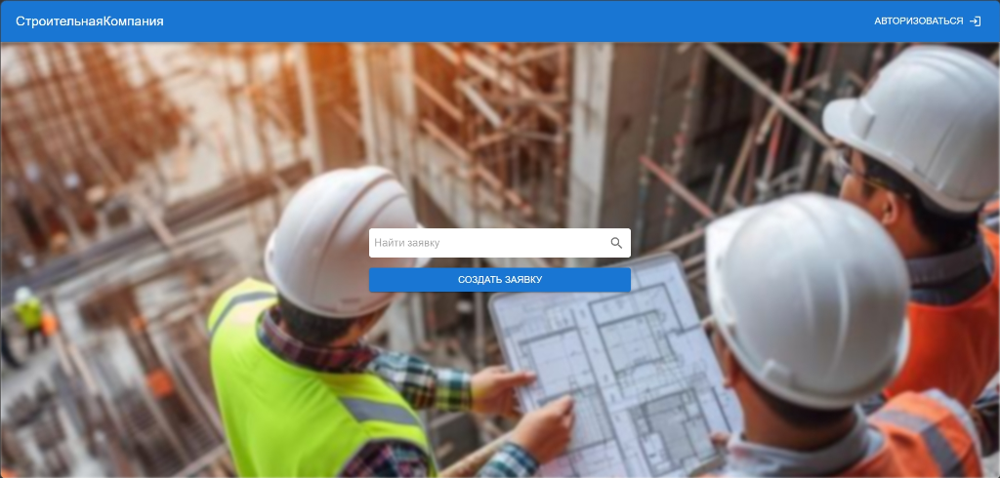
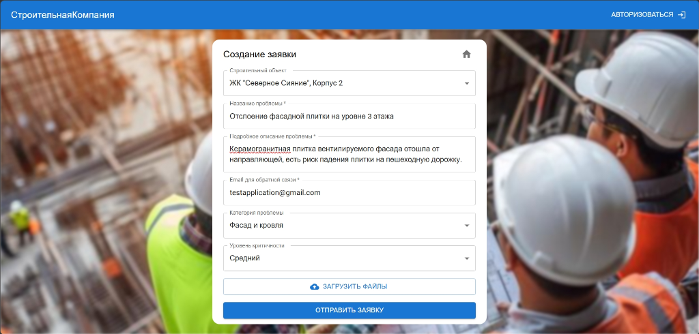
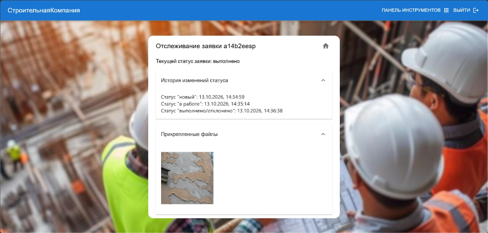
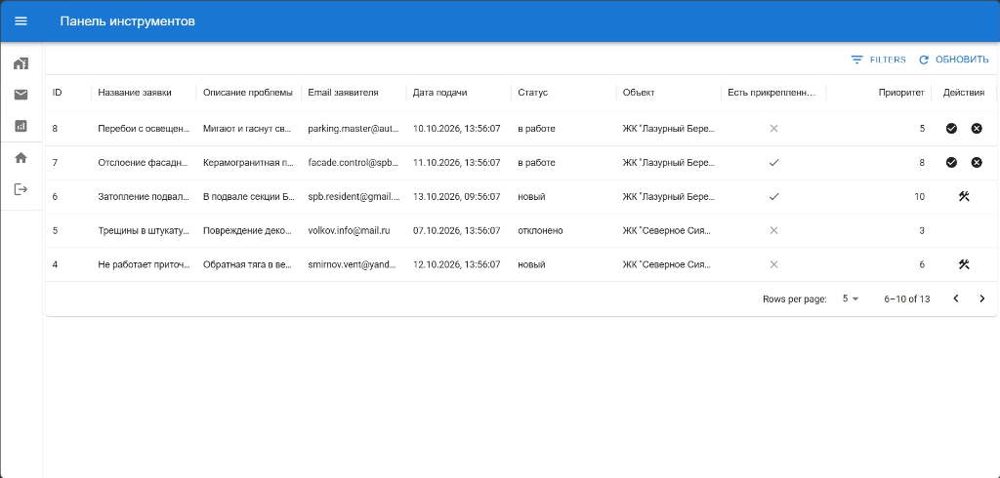
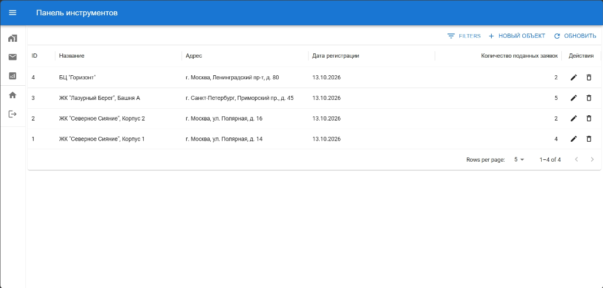
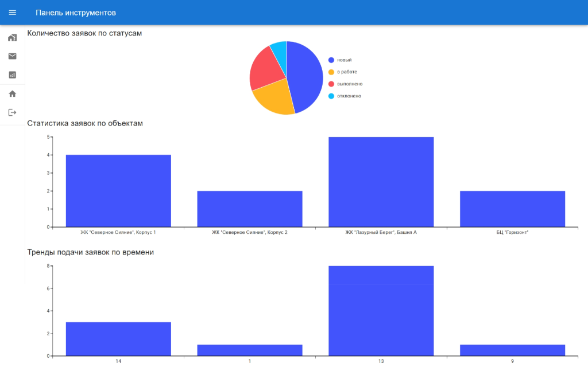

# Презентация проекта «DefectTrack» (Defect Management System)
**Система автоматизированного приёма, оценки и управления рекламациями на строительные дефекты**

> **Исполнитель:** Машнев М. (студент гр. бИВТ-231, ВГТУ, каф. АВС)  
> **Руководитель:** Сафронов В. В.  
> **Год:** 2026

---

## Слайд 1. Титульный слайд
- **Заголовок:** DefectTrack — Defect Management System
- **Подзаголовок:** Полнофункциональная система приёма, алгоритмического скоринга и диспетчеризации строительных рекламаций
- **Тезис:** От хаотичных журналов и чатов — к прозрачной цифровой экосистеме гарантийного обслуживания объектов недвижимости.
- **Автор:** Машнев М., гр. бИВТ-231
- **Научный руководитель:** Сафронов В. В.

---

## Слайд 2. Проблематика и цели проекта
### Актуальность:
- В гарантийный период эксплуатации ЖК управляющие компании и застройщики получают сотни обращений.
- При ручной обработке возникают субъективность оценки критичности, потеря аварийных заявок, срыв сроков устранения и отсутствие прозрачной аналитики по подрядчикам.

### Цели системы:
1. **Единое окно приёма заявок** 24/7 без барьера предварительной регистрации жильцов.
2. **Алгоритмический расчёт приоритета (Scoring Engine 1–10)** для исключения человеческого фактора.
3. **Строгий жизненный цикл заявки** с фиксацией таймстемпов каждого этапа.
4. **Централизованный архив медиафиксации** дефектов (фото/видео).
5. **Сквозная визуальная аналитика** качества строительства объектов в реальном времени.

---

## Слайд 3. Архитектура и стек технологий
### Современный технологический стек:
- **Backend (Go 1.27+):**
  - Высокопроизводительный микрофреймворк **Gin** (REST API).
  - Поддержка двух СУБД: встроенный **SQLite** (автономный мгновенный запуск) и **PostgreSQL** (продакшн в Docker).
  - Безопасность: **JWT** (HMAC-SHA256) + хеширование паролей **bcrypt**.
  - Чистая архитектура: разделение слоев Handler → Service → Repository → Model.
- **Frontend (React 19 + TypeScript):**
  - Архитектура **Feature-Sliced Design (FSD)** для надежности и масштабируемости.
  - UI-библиотека **Material-UI (MUI)** и компоненты **MUI X** (DataGrid, X-Charts).
  - Управление состоянием: реактивный менеджер **MobX**.
  - Маршрутизация: **React Router v6**, HTTP-клиент: **Axios**.

---

## Слайд 4. Главная страница (Публичный контур)
### Витрина сервиса для жителей и дольщиков:
- Круглосуточный приём обращений без предварительной регистрации.
- **Быстрый трекинг рекламации прямо с главной страницы:** ввод прямого номера заявки или зашифрованного хеш-кода.
- Кнопка прямого перехода к мастеру оформления заявки.
- Адаптивный интерфейс для мобильных устройств, планшетов и ПК.

*Рисунок 1 — Главная страница с поиском и переходом к созданию заявки*

---

## Слайд 5. Оформление заявки на строительный дефект
### Удобная форма подачи рекламации:
- **Выбор объекта:** привязка к конкретному ЖК или бизнес-центру из единого реестра.
- **Категоризация дефекта:** выбор инженерной системы (Водоснабжение, Электрика, Окна, Вентиляция, Фасад, Отделка).
- **Базовая критичность:** указание жильцом срочности (Низкий / Средний / Высокий / Аварийный).
- **Валидация контактов:** проверка корректности введенного email заявителя.
- **Мультизагрузка файлов:** прикрепление фото и видео дефекта (до 10 файлов).

*Рисунок 2 — Пример заполнения рекламации (объект, категория дефекта, описание и контакты)*

---

## Слайд 6. Интеллектуальный Scoring Engine (Расчёт приоритета 1–10)
### Многофакторная формула оценки срочности:
$$Priority = Base + Category + LengthBonus + MediaBonus + NightBonus + RepeatBonus + BuildingBonus$$

1. **Базовая критичность:** от 1 (низкая) до 4 (аварийная).
2. **Вес инженерной системы:** +1...+3 балла (Водоснабжение/Электрика = 3, Отделка = 1).
3. **Полнота описания:** +1 балл за ≥ 50 символов, +2 балла за ≥ 200 символов.
4. **Медиафиксация:** +1 балл за файлы, +2 балла за ≥ 3 файлов, +1 балл за видеозапись.
5. **Ночной фактор (22:00 – 06:00):** +2 балла (вероятность острой аварийной ситуации).
6. **Повторяемость дефекта:** +2 балла при наличии аналогичных дефектов в этом здании.
7. **Антирейтинг объекта:** +1 балл, если объект лидирует по числу рекламаций.
*Итоговый скоринг нормируется в строгом диапазоне от 1 до 10.*

---

## Слайд 7. Прозрачный трекинг заявки
### Клиентский сервис отслеживания:
- Доступ по уникальному коду заявки (например, `a14b2eesp`) или прямому номеру `ID`.
- Отображение актуального статуса заявки в реальном времени.
- **Интерактивный аккордеон с хронологией изменения статусов:**
  - Дата и точное время подачи (`новый`).
  - Дата и точное время взятия в работу (`в работе`).
  - Дата и точное время завершения (`выполнено / отклонено`).
- **Блок прикрепленных медиаматериалов:** отображение фото дефекта, прикрепленного при подаче.

*Рисунок 3 — Экран отслеживания заявки с историей этапов и фотофиксацией дефекта*

---

## Слайд 8. Рабочее место инженера-менеджера (Реестр заявок)
### Профессиональный диспетчерский пульт:
- Защищенный вход по JWT-токену (`admin@a.a` / `admin123`).
- Интерактивная таблица **MUI DataGrid**:
  - Серверная пагинация (по 5/10/20 строк).
  - Сортировка по колонкам (ID, приоритет, дата, статус, объект).
  - Фильтрация по статусам, объектам и критичности.
- **Управление жизненным циклом заявки в 1 клик:**
  - `Новый` → кнопка «Принять в работу».
  - `В работе` → кнопки «Выполнено» и «Отклонить».
  - Модальное окно мотивированного отклонения заявки (с обязательным указанием причины).

*Рисунок 4 — Реестр заявок менеджера с приоритетами, статусами и быстрыми действиями*

---

## Слайд 9. Паспорт объектов и реестр зданий
### Управление жилыми комплексами и зданиями:
- Карточки объектов (ЖК "Северное Сияние", ЖК "Лазурный Берег", БЦ "Горизонт").
- Автоматический подсчёт общего числа поданных дефектов по каждому объекту.
- Возможность добавления нового здания и редактирования адресов.
- Каскадное обновление статистики при регистрации новых обращений.

*Рисунок 5 — Реестр строительных объектов со счетчиками поступивших рекламаций*

---

## Слайд 10. Дашборд аналитики качества строительства
### Визуализация метрик в реальном времени (MUI X-Charts):
1. **Круговая диаграмма (PieChart):** баланс статусов (Новый / В работе / Выполнено / Отклонено).
2. **Столбчатая диаграмма (BarChart):** антирейтинг объектов по количеству рекламаций.
3. **Временные тренды (BarChart):** распределение подачи обращений по часам суток для оптимизации графика дежурств диспетчерской службы.

*Рисунок 6 — Аналитический дашборд с распределением по статусам, объектам и часам*

---

## Слайд 11. Итоги и соответствие ТЗ
### Результаты выполнения технического задания:
| Требование ТЗ | Статус реализации |
|---|:---:|
| Клиент-серверное web-приложение (SPA + REST API) | ✅ Выполнено |
| Сервер на Go (Gin) + поддержка SQLite/PostgreSQL | ✅ Выполнено |
| Фронтенд на React 19 + TypeScript + MUI + FSD | ✅ Выполнено |
| Авторизация менеджера по JWT + bcrypt | ✅ Выполнено |
| Форма подачи рекламаций с мультизагрузкой файлов | ✅ Выполнено |
| Алгоритмический скоринг приоритета дефектов (1–10) | ✅ Выполнено |
| Отслеживание заявок по номеру / коду без регистрации | ✅ Выполнено |
| Реестр заявок DataGrid с фильтрацией и жизненным циклом | ✅ Выполнено |
| Реестр объектов и учет числа обращений | ✅ Выполнено |
| Интерактивный аналитический дашборд с диаграммами | ✅ Выполнено |
| Начальное наполнение тестовыми данными (сидами) | ✅ Выполнено |

---

## Слайд 12. Заключение и планы развития
### Эффект от внедрения:
- Сокращение времени первичной диспетчеризации аварийных заявок до минимума.
- Полная прозрачность гарантийного процесса для дольщиков и жильцов.
- Объективная база данных для рекламационной работы с подрядчиками.

### Перспективы развития системы:
- Telegram-бот для жильцов и мобильное приложение для выездных мастеров.
- Интеграция с 1С и системами управления строительством.
- Автоматическое распознавание дефектов на фото с помощью нейросетей (Computer Vision).

**Спасибо за внимание! Готов ответить на ваши вопросы.**
